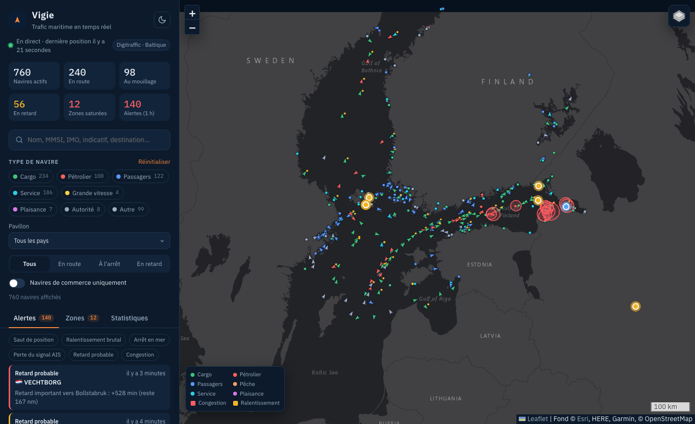
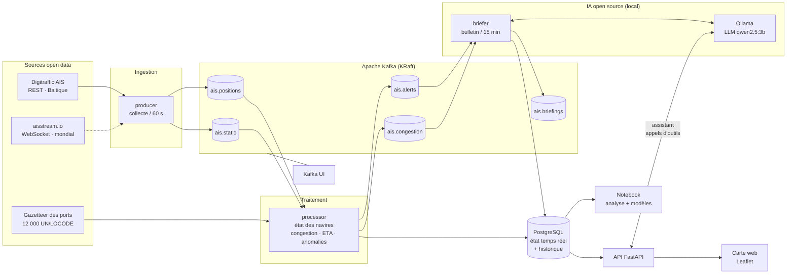
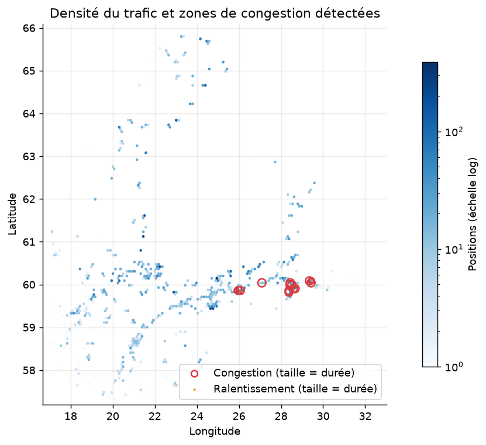
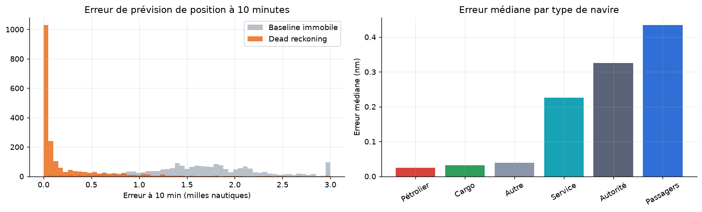

# Vigie — suivi du trafic maritime en temps réel

> Projet IPSSI, module Open Data. **Sujet 3 : « Suivez le flux maritime en temps réel »**

Vigie collecte chaque minute les positions AIS des navires depuis une API open data et les publie
dans **Apache Kafka**. Un processeur de flux les exploite pour détecter les **zones de
congestion et de ralentissement**, les **retards probables** et les **comportements anormaux**.
Le tout est restitué sur une **carte web interactive** avec filtres et suivi d'un navire.



---

## Objectifs du sujet et réalisation

| Objectif de l'énoncé | Réalisation |
|---|---|
| Utiliser une API qui fournit en live les données des bateaux | API **Digitraffic** (open data, sans clé, licence CC BY 4.0). La source **aisstream.io** (couverture mondiale, clé gratuite) est aussi prise en charge |
| Collecter les positions toutes les minutes | `maritime/producer.py` : un appel par minute, positions dédoublonnées (incrémental via `from=`) et fiches navires toutes les 10 min |
| Publier les données dans Apache Kafka | Topics `ais.positions` (3 partitions, clé = MMSI), `ais.static`, `ais.alerts` et `ais.congestion` |
| Détecter les zones de ralentissement ou de congestion | Grille d'environ 5 km : file de cargos au mouillage (**congestion**) ou vitesse inférieure à 50 % de la normale apprise (**ralentissement**) |
| Détecter les retards | Comparaison entre l'ETA déclarée par l'équipage et l'ETA recalculée (distance restante / vitesse moyenne) |
| Détecter les anomalies | Saut de position impossible, ralentissement brutal en mer, arrêt en mer, perte du signal AIS |
| Suivre un navire en particulier | Fiche navire, trajectoire sur 2 h, 6 h ou 24 h, profil de vitesse et mode **« Suivre »** (la carte reste centrée) |
| Visualiser le trafic mondial ou régional sur une carte | Carte Leaflet en canvas (plusieurs milliers de navires orientés selon leur cap), couches zones, alertes et balisage OpenSeaMap |
| Interface dynamique avec filtres (nom, type, pays) | Recherche (nom, MMSI, IMO, indicatif, destination), filtres type, pavillon, état et commerce, actualisation toutes les 15 s |
| *Bonus* : IA générative open source | **Bulletin de situation** rédigé toutes les 15 min et **assistant conversationnel** qui interroge la base, avec un LLM à poids ouverts (Qwen 2.5) exécuté localement par **Ollama** |
| Analyse et modèle de prédiction (rappels) | Notebook `notebooks/analyse_trafic.ipynb` : data viz matplotlib, **prévision de position à 10 min** et **Isolation Forest** |

---

## Architecture



| Service | Rôle | Port |
|---|---|---|
| `kafka` | Broker Apache Kafka 3.8 en mode KRaft (sans ZooKeeper) | 9092 |
| `kafka-ui` | Exploration des topics et des messages | [8080](http://localhost:8080) |
| `producer` | Collecte AIS → Kafka | – |
| `processor` | Kafka → détection → PostgreSQL et topics d'alertes | – |
| `postgres` | Stockage de l'état courant, de l'historique et des alertes | 5433 |
| `api` | API REST et interface web | [8000](http://localhost:8000) |
| `ollama` | Serveur de LLM open source local (modèles à poids ouverts) | 11434 |
| `ollama-pull` | Télécharge le modèle au premier démarrage puis s'arrête | – |
| `briefer` | Kafka (alertes, zones) → bulletin rédigé par le LLM → `ais.briefings` et PostgreSQL | – |

**Pourquoi ce découpage ?** Kafka découple la collecte du traitement. Si le processeur
redémarre, il reprend à son dernier offset sans perdre de message, et il recharge son état récent
(trajectoires, vitesses de référence, alertes déjà émises) depuis PostgreSQL. La clé de partition
MMSI garantit que les positions d'un même navire sont traitées dans l'ordre. On peut ajouter
d'autres consommateurs (archivage, Spark, alerting) sans toucher au producteur.

---

## Démarrage rapide

Prérequis : Docker Desktop (ou Docker Engine et Compose v2).

```bash
git clone https://github.com/theoUniv/vigie-trafic-maritime.git
cd vigie-trafic-maritime
docker compose up -d --build
```

- Carte : **http://localhost:8000** (premiers navires visibles en moins d'une minute)
- Documentation de l'API : http://localhost:8000/docs
- Kafka UI : http://localhost:8080

Les détections gagnent en pertinence après une trentaine de minutes : il faut le temps
d'accumuler des trajectoires et d'apprendre les vitesses de référence des zones.

```bash
docker compose logs -f producer processor   # suivre le pipeline
docker compose down                         # arrêter (ajouter -v pour effacer les données)
```

### Passer au trafic mondial (aisstream.io)

```bash
cp .env.example .env
# dans .env : AIS_SOURCE=aisstream, AISSTREAM_API_KEY=<votre clé>, AISSTREAM_BBOXES=...
docker compose up -d producer
```

Le flux WebSocket continu est regroupé en instantanés d'une minute (dernière position de chaque
navire). Le reste du pipeline est identique.

> La source par défaut (Digitraffic) a été testée de bout en bout. La source aisstream suit la
> documentation publique d'aisstream.io mais n'a pas pu être testée faute de clé.

---

## Données

| Donnée | Source | Licence |
|---|---|---|
| Positions et fiches navires AIS | [Digitraffic — Fintraffic](https://www.digitraffic.fi/en/marine-traffic/) (`/api/ais/v1/locations`, `/vessels`) | CC BY 4.0 |
| Positions AIS mondiales (optionnel) | [aisstream.io](https://aisstream.io) | Conditions aisstream |
| Ports (UN/LOCODE et coordonnées) | Digitraffic Port Call API | CC BY 4.0 |
| Balisage maritime | [OpenSeaMap](https://www.openseamap.org) | CC BY-SA |
| Fond de carte | Esri World Gray Canvas | Attribution |
| Pavillon | Déduit du MMSI (MID, table ITU) | – |

### Messages Kafka

```jsonc
// ais.positions — clé : MMSI
{"mmsi": 230617000, "ts": 1794239108111, "lat": 60.214, "lon": 25.202, "sog": 11.3,
 "cog": 87.2, "heading": 88, "nav_status": 0, "rot": 0, "source": "digitraffic",
 "ingested_at": 1794239110000}

// ais.static — clé : MMSI
{"mmsi": 273218530, "name": "POLA ANASTASIA", "ship_type": 70, "callsign": "UFON",
 "imo": 9897690, "destination": "RU LED", "eta": {"month": 11, "day": 10, "hour": 4, "minute": 30},
 "draught": 3.0, "length": 141, "width": 17, "source": "digitraffic"}

// ais.alerts
{"kind": "SLOWDOWN", "severity": "warning", "mmsi": 246554000, "lat": 59.62, "lon": 22.9,
 "message": "Vitesse passée de 12.4 à 0.8 nœuds hors zone portuaire", "label": "Ralentissement brutal"}
```

---

## Logique de détection

Toute la logique est dans `maritime/processing/`. Ce sont des fonctions pures, sans Kafka ni
base de données, couvertes par des tests unitaires.

| Détection | Règle | Paramètres |
|---|---|---|
| **Congestion** | Dans une cellule d'environ 5 km, au moins 3 cargos ou pétroliers à l'arrêt ou au mouillage, représentant au moins 60 % des navires de charge présents. Les remorqueurs et ferries à quai sont ignorés | `CELL_KM`, `CONGESTION_MIN_VESSELS` |
| **Ralentissement de zone** | Vitesse moyenne de la cellule inférieure à 50 % de sa vitesse de référence (moyenne mobile exponentielle apprise en continu, rechargée sur 24 h au redémarrage) | `slowdown_ratio=0.5` |
| **Retard probable / important** | ETA recalculée (orthodromie × 1,25 / vitesse moyenne sur 30 min) postérieure de plus de 60 / 240 min à l'ETA déclarée. Alerte uniquement pour les navires de commerce à moins de 300 nm | `DETOUR_FACTOR`, seuils dans `eta.py` |
| **Saut de position** | Vitesse implicite entre deux positions supérieure à 60 nœuds et à 3 × la vitesse déclarée + 30 (erreur GPS ou usurpation AIS) | `MAX_PLAUSIBLE_KN` |
| **Ralentissement brutal** | Vitesse de croisière ≥ 8 nœuds sur les 30 dernières minutes, puis vitesse < 30 % de celle-ci, hors rayon de 5 nm autour d'un port | `SLOWDOWN_*` |
| **Arrêt en mer** | Immobile depuis au moins 20 min hors port alors que le statut AIS indique « en route » | `STOP_MIN_DURATION` |
| **Perte du signal AIS** | Navire suivi en mouvement qui n'émet plus depuis au moins 20 min | `AIS_GAP_MIN` |

Les conditions persistantes (arrêt, perte de signal, retard, congestion) ne déclenchent une alerte
qu'à leur **apparition** et se réarment à leur disparition. Un délai anti-rebond de 30 min évite
le spam d'alertes.

La destination AIS est un champ libre saisi par l'équipage (`FI HEL`, `HELSINKI`, `FI/HANKO`,
`EE TLL>FI HEL`…). Elle est résolue vers un port géolocalisé par code LOCODE, par nom normalisé
ou par alias. Les itinéraires multi-escales (`SESTO<>FIMHQ<>FIHEL`) sont volontairement ignorés.

---

## IA générative open source (Ollama)

Vigie intègre un **LLM à poids ouverts exécuté localement** par [Ollama](https://ollama.com) :
aucune donnée ne quitte la machine, aucune clé ni service payant. Le modèle par défaut,
`qwen2.5:3b` (licence Qwen, ~2 Go), tourne sur CPU, écrit bien le français et sait appeler des
outils. On peut le changer avec `LLM_MODEL` (`llama3.2:3b`, `mistral:7b`, `qwen2.5:7b`…).

Au premier `docker compose up`, le service `ollama-pull` télécharge le modèle (quelques minutes).
Suivre l'avancement : `docker compose logs -f ollama-pull briefer`.

**Bulletin de situation (onglet « Bulletin »).** Le service `briefer` est un nouveau consommateur
Kafka, ajouté sans modifier le producteur ni le processeur. Il lit `ais.alerts` et
`ais.congestion` et, toutes les 15 minutes, condense la dernière heure en **faits structurés**
(indicateurs de flotte, alertes par gravité, zones saturées). Il fait ensuite rédiger un
bulletin en français par le LLM, publié sur `ais.briefings` et stocké en base. Le LLM ne reçoit que
des faits calculés par le pipeline et il a pour consigne de ne rien inventer. Si le LLM est
indisponible, un **bulletin gabarit** déterministe est produit à la place.

**Assistant (onglet « Assistant »).** `POST /api/ask` utilise l'**appel d'outils** (*tool calling*) :
le modèle ne connaît pas les données, il choisit parmi six outils (recherche de navires, fiche
navire, zones, alertes, statistiques, dernier bulletin) qui interrogent PostgreSQL, puis
formule sa réponse à partir des résultats. Les MMSI cités sont cliquables et ouvrent la fiche du navire.

```bash
curl -X POST localhost:8000/api/ask -H "Content-Type: application/json"      -d '{"question": "Quels cargos sont en retard vers Helsinki ?"}'
```

Pour désactiver l'IA : `LLM_URL=` (vide) dans `.env`, et ne pas lancer `ollama`.
Le reste de Vigie fonctionne normalement.

> Sur CPU, un bulletin prend de 20 à 60 s et une réponse de l'assistant jusqu'à une minute (plusieurs
> allers-retours d'outils). Avec une carte graphique NVIDIA, ajouter une réservation GPU au service
> `ollama` accélère nettement la génération.

---

## API REST

| Endpoint | Description |
|---|---|
| `GET /api/vessels?q=&category=&country=&status=&commercial=&bbox=` | Dernière position des navires actifs, avec filtres |
| `GET /api/search?q=` | Recherche par nom, MMSI, IMO, indicatif ou destination |
| `GET /api/vessels/{mmsi}` | Fiche complète : identité, position, estimation d'ETA, anomalies |
| `GET /api/vessels/{mmsi}/track?hours=6` | Trajectoire |
| `GET /api/congestion?min_level=dense` | Zones courantes : congestion, ralentissement, trafic dense |
| `GET /api/anomalies?hours=6&kind=` | Flux d'alertes |
| `GET /api/stats` | Indicateurs, répartition par type, débit d'ingestion |
| `GET /api/meta` | Valeurs disponibles pour les filtres |
| `GET /api/briefings?limit=10` | Derniers bulletins de situation |
| `POST /api/ask` | Question en langage naturel à l'assistant (`{"question": "...", "history": [...]}`) |
| `GET /api/llm/status` | État du LLM (activé, modèle téléchargé) |

Documentation interactive : http://localhost:8000/docs

---

## Analyse et modèles

Le notebook [`notebooks/analyse_trafic.ipynb`](notebooks/analyse_trafic.ipynb) lit la base
alimentée par le pipeline et exporte ses figures dans `docs/figures/`.

```bash
uv venv && uv pip install -e ".[analysis,dev]"     # ou : pip install -e ".[analysis,dev]"
.venv/bin/jupyter lab notebooks/analyse_trafic.ipynb
```

| | |
|---|---|
|  |  |

- **Modèle 1, prévision de position à 10 min** (*dead reckoning*). C'est la base de l'ETA
  recalculée et du suivi. Elle est évaluée sur les trajectoires réelles et comparée à une
  référence « navire immobile ».
- **Modèle 2, Isolation Forest.** Détection non supervisée de profils de navigation atypiques
  (variabilité de vitesse, changements de cap, vitesses implicites, coupures), comparée aux
  alertes produites par les règles.

---

## Tests

```bash
.venv/bin/python -m pytest
```

Les 59 tests couvrent la géographie, le décodage AIS (ETA, pavillons, valeurs sentinelles), la
résolution des destinations, les détecteurs d'anomalies, la congestion et l'estimation d'ETA.
Ils couvrent aussi la couche IA (faits du bulletin, gabarit de repli, boucle d'appel d'outils),
testée avec un faux client, donc sans LLM.

---

## Structure du dépôt

```
maritime/
  config.py            configuration (variables d'environnement)
  ais.py               référentiels AIS : types, statuts, pavillons (MID), ETA
  geo.py               distances, grille spatiale
  ports.py             gazetteer UN/LOCODE et résolution des destinations
  kafka_io.py          topics, producteur et consommateur JSON
  sources/             digitraffic.py (REST), aisstream.py (WebSocket)
  producer.py          collecte → Kafka
  processing/          state, anomalies, congestion, eta (logique pure)
  processor.py         Kafka → détection → PostgreSQL et topics d'alertes
  db.py                schéma et écritures PostgreSQL
  llm/                 client Ollama, bulletin (faits + prompt), assistant (outils)
  briefer.py           Kafka → bulletin rédigé par le LLM → ais.briefings et PostgreSQL
  api/app.py           API FastAPI et service de l'interface
web/                   interface (HTML, CSS, JS, Leaflet)
notebooks/             analyse et modèles
tests/                 tests unitaires
docs/figures/          figures exportées pour la présentation
docker-compose.yml     stack complète
```

---

## Limites et pistes

- **Couverture** : sans clé, Digitraffic couvre la mer Baltique. Pour le trafic mondial, il faut
  utiliser `AIS_SOURCE=aisstream`.
- **ETA déclarées** : souvent non mises à jour par les équipages, ce qui explique une partie des
  « retards » observés. L'écart reste un bon indicateur à surveiller.
- **Routes** : la distance restante est une orthodromie corrigée d'un facteur 1,25. Un graphe de
  routes maritimes (ex. *searoute*) affinerait l'ETA.
- **Passage à l'échelle** : le processeur Python suffit pour quelques milliers de navires. Pour un
  flux mondial complet, on pourrait le remplacer par **Spark Structured Streaming** ou **Kafka
  Streams**, stocker l'historique dans **TimescaleDB** ou **Cassandra**, et orchestrer les analyses
  avec **Airflow**.

---

Données AIS © Fintraffic / Digitraffic, licence CC BY 4.0.
